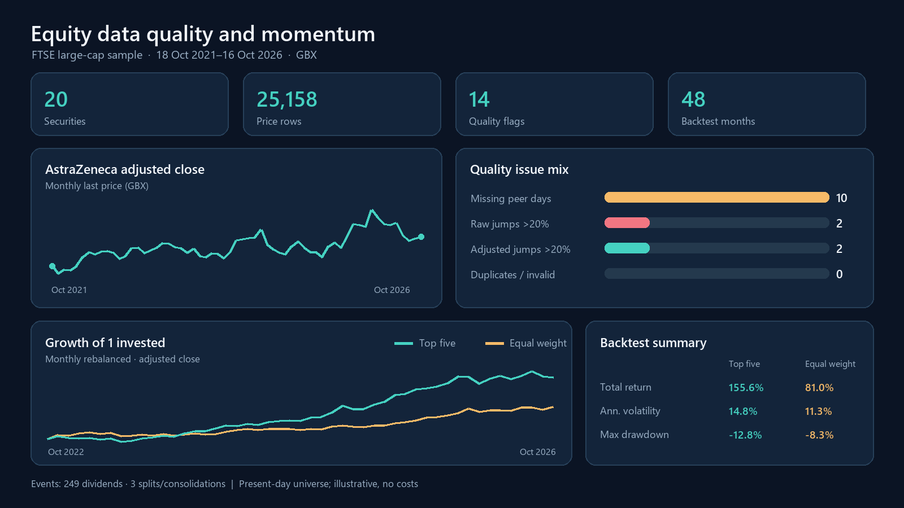

# Equity Data Quality and Backtest Pipeline

A compact research pipeline for 20 London-listed large-cap equities. It combines daily prices, point-in-time identifiers, corporate actions, quality checks, Snowflake/dbt models, and a 12-month momentum backtest. The latest verified local run covers **18 October 2021–16 October 2026**.



*This is a static preview generated from the pipeline outputs. The [Power BI page specification](powerbi/README.md) describes the native report; a `.pbix` has not been saved because Power BI access was not available in this run.*

## What it does

1. Pulls daily OHLCV, `Adj Close`, dividends and split ratios from Yahoo Finance through [`yfinance`](https://ranaroussi.github.io/yfinance/reference/yfinance.price_history.html). The `end` date is exclusive.
2. Joins each date to a [security master](data/reference/security_master.csv) with company, ticker, LSE TIDM, ISIN, broad analyst-assigned sector and GBX quote currency. ISINs are checked against [London Stock Exchange instrument pages](https://www.londonstockexchange.com/) linked in each row. GSK, Anglo American and Unilever have dated identifier changes.
3. Keeps `Close` (Yahoo's split-adjusted, cash-dividend-unadjusted series), `Adj Close` (Yahoo's dividend-and-split-adjusted series), and an illustrative reconstructed `pre_split_nominal_close`. Corporate actions remain explicit events.
4. Flags missing peer-calendar dates, duplicate ticker/date rows, null or nonpositive prices, and raw/adjusted daily moves above 20%. It writes event-level and grouped quality tables.
5. Exports CSVs for a Snowflake raw layer, with dbt security, price, event and quality models plus example SQL.
6. Forms a 12-month return signal at each month-end, then holds the top five names equally for the next month. It compares with an equal-weight benchmark over the same eligible universe.

## Quick start

Python 3.11+ is recommended.

```powershell
python -m venv .venv
.\.venv\Scripts\Activate.ps1
pip install -r requirements.txt
python src/equity_pipeline.py --start 2021-10-18 --end 2026-10-17
python src/render_preview.py
python -m unittest discover -s tests -v
```

Omit the dates to request a rolling five-year window ending tomorrow. The output files are written to `data/processed/` and excluded from Git because Yahoo states its API is for personal use. The checked-in findings and dashboard preview allow the results to be inspected without redistributing the full price series. A fresh run can differ as Yahoo revises history and actions.

## Output tables

| File | Grain / purpose |
|---|---|
| `prices.csv` | Ticker × trading day, identifier, prices, dividend and split factors |
| `corporate_actions.csv` | Ticker × ex-date event |
| `quality_issues.csv` | One row per flag |
| `quality_summary.csv` | Issue type with counts and affected tickers |
| `backtest_monthly.csv` | Holding month returns and wealth indices |
| `backtest_holdings.csv` | Five selected names per signal month |
| `backtest_metrics.csv` | Return, volatility and drawdown summary |
| `run_manifest.json` | Requested window, coverage and download failures |

## Snowflake and dbt

A [Snowflake trial account](https://docs.snowflake.com/en/user-guide/admin-trial-account) is sufficient. With a signed-in account and warehouse, install `requirements-warehouse.txt`, set `SNOWFLAKE_ACCOUNT`, `SNOWFLAKE_USER`, and `SNOWFLAKE_WAREHOUSE`, then run:

```powershell
python src/load_snowflake.py
Copy-Item profiles.yml.example profiles.yml
dbt debug --profiles-dir .
dbt build --profiles-dir .
```

The loader and dbt profile use browser SSO (`externalbrowser`) and do not store a password. The loader creates `EQUITY_RESEARCH.RAW` and stages the CSVs. dbt builds `EQUITY_RESEARCH.ANALYTICS`; [example_queries.sql](sql/example_queries.sql) checks coverage, flags, and event-price joins. The warehouse load and dbt commands have not been executed in a Snowflake account here.

## Power BI

The [one-page layout and DAX measures](powerbi/README.md) use the generated CSVs. Power BI Desktop or a signed-in workspace is needed to save the native report. The checked-in image is a preview of the requested page, not a `.pbix` screenshot.

## Findings from the verified local run

The pull returned **25,158 price rows across all 20 names**, with **249 dividend events and three split/consolidation events**. The quality checks flagged **10 peer-calendar gaps** and **two adjusted moves above 20%**, both in `RR.L`; they found no duplicates or invalid prices. The [quality report](reports/quality_report.csv) and [findings note](reports/findings.md) give the detail.

Across 48 monthly holding periods, top-five momentum returned **155.57% total** (26.44% annualized, 14.82% annualized volatility, −12.82% maximum drawdown). Equal weight returned **80.96% total** (15.98% annualized, 11.31% annualized volatility, −8.35% maximum drawdown). These are in-sample, illustrative results.

## Method limits

- This is a fixed set of current stocks, so the comparison has survivorship bias and is not a historical FTSE 100 constituent backtest.
- `SHEL.L` begins on 31 January 2022; the current Shell line does not span the full window. GSK, Anglo American and Unilever changed ISIN within the window.
- A peer-union calendar is a screening proxy, not an official LSE session calendar. Missing-day flags need review before data repair.
- Vendor-adjusted prices and corporate actions can be restated. The pipeline does not independently reconstruct total return from raw transactions.
- No transaction costs, slippage, taxes, market impact or currency conversion are included. The prices are in GBX.
- The Snowflake and native Power BI components are supplied as code and a page specification pending account access; no claim of a completed live load or `.pbix` is made.

This project is for technical demonstration and research, not investment advice.
